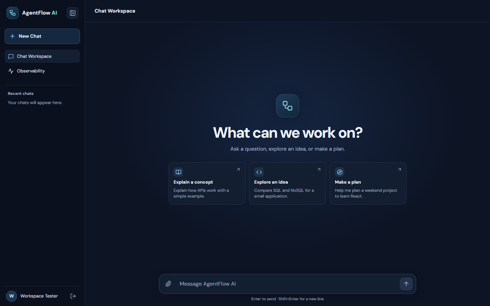
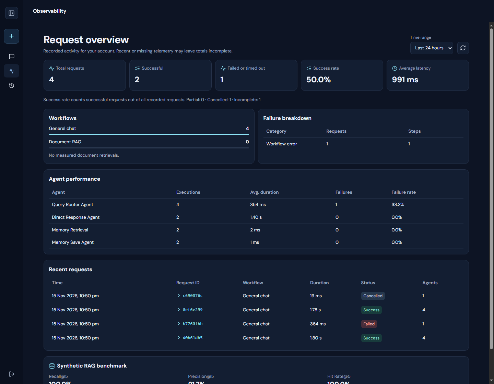

# AgentFlow AI

AgentFlow AI is a local-first chat workspace for exploring multi-agent reasoning and asking questions about your own documents. It is designed as a portfolio project for developers who want to see how retrieval, generation, and request failures fit together.

## What it solves

Multi-step questions benefit from planning, research, critique, and synthesis. Document questions need answers grounded in the selected files. Model output can still be wrong, so the app shows excerpts, measures retrieval on a repeatable benchmark, and lets each account inspect its own request history.

- **General chat** streams Groq responses from a LangGraph workflow with live agent activity.
- **Document chat** accepts text-based PDF and UTF-8 TXT files, retrieves owner-scoped passages, and shows citations with a page or chunk and an excerpt.
- **Guardrails** separate instructions from document evidence, check document ownership server-side, limit request size, and validate citation IDs.
- **Reliability** includes request IDs, measured step durations, bounded provider retries, cancellation, partial results, and safe errors.
- **Observability** shows recorded request outcomes, agent timings, failure categories, retrieval counts, and a separate synthetic RAG benchmark.
- **Authentication** uses JWTs and MongoDB account records.

## Architecture

~~~mermaid
flowchart LR
    UI[React workspace] --> API[FastAPI]
    API --> Route{Documents selected?}
    Route -->|No| Graph[LangGraph general workflow]
    Route -->|Yes| RAG[Owner-scoped document retrieval]
    Graph --> Groq[Groq]
    RAG --> Groq
    RAG --> Vectors[(Chroma document vectors)]
    Graph --> Memory[(Chroma conversation memory)]
    API --> Mongo[(MongoDB accounts, document metadata, telemetry)]
    Groq --> SSE[SSE answer and activity]
    SSE --> UI
~~~

| Technology | Why it is used |
|---|---|
| React and Vite | Render the chat, document controls, responsive navigation, and dashboard. |
| FastAPI | Validate typed requests, verify identity, and serve streaming and JSON endpoints. |
| LangGraph | Coordinate planning, parallel research, critique, revision, memory, and synthesis for complex general chat. |
| Groq | Generate answers with an existing configurable model and support streaming. |
| MongoDB | Store account records, document metadata, and account-scoped request telemetry. |
| ChromaDB | Persist semantic document vectors and conversation memory in separate local collections. |
| MiniLM via ONNX | Generate indexing and query embeddings locally without using Groq quota. |

See [Architecture](docs/ARCHITECTURE.md) for the agent and data flows.

## Getting started on Windows

From PowerShell with Git, Python 3.13, and a Vite-compatible Node.js release installed:

~~~powershell
git clone https://github.com/Akash814106/multi-agent-ai-platform.git
Set-Location multi-agent-ai-platform
py -3.13 -m venv venv
.\venv\Scripts\python.exe -m pip install -r requirements.txt -r backend/requirements-test.txt
npm.cmd --prefix frontend ci

Copy-Item backend/.env.example backend/.env
Copy-Item frontend/.env.example frontend/.env
notepad backend/.env
notepad frontend/.env
~~~

Set these backend variables in the ignored environment file:

~~~dotenv
MONGO_URI=<MongoDB connection URI>
JWT_SECRET_KEY=<random local JWT signing secret>
JWT_ALGORITHM=HS256
GROQ_API_KEY=<Groq API key>
EXA_API_KEY=<Exa API key for the research agent>
~~~

For Atlas, allow the machine's IP under Network Access and use a database user with read/write access to the application database. The app creates an owner/time index on the telemetry collection. Keep the local frontend API URL at **http://localhost:8000**. The first embedding request may download MiniLM model files.

Run the services in separate terminals from the repository root:

~~~powershell
.\venv\Scripts\python.exe -m uvicorn backend.api.main:app --reload --port 8000
~~~

~~~powershell
npm.cmd --prefix frontend run dev -- --port 5173 --strictPort
~~~

Open [localhost:5173](http://localhost:5173), create an account, and sign in.

## Testing and evaluation

~~~powershell
.\venv\Scripts\python.exe -m unittest backend.test_chat_workspace backend.test_document_rag backend.test_rag_evaluation backend.test_observability -v
.\venv\Scripts\python.exe -m compileall -q backend
.\venv\Scripts\python.exe -m backend.evaluation.run --top-k 5
npm.cmd --prefix frontend run lint
npm.cmd --prefix frontend run build
git diff --check
~~~

Dataset 1.0 passed **8/8 synthetic cases** with **100% recall@5, 91.7% precision@5, and 100% hit rate@5**. The benchmark uses real local embeddings, labelled passages, and deterministic answer fixtures. Retrieval scores average the six answerable cases. An obsolete policy retrieved alongside the correct policy reduced precision. The result measures this small benchmark; it does not measure live Groq answer accuracy.

The runner writes its detailed report to the ignored **rag_eval_results.json**. To refresh the dashboard's allowlisted aggregate summary from the synthetic dataset, run:

~~~powershell
.\venv\Scripts\python.exe -m backend.evaluation.run --top-k 5 --publish-summary
~~~

## Screenshots and demo

These screenshots show the running local app. The dashboard's request metrics came from the browser smoke test with mocked providers and database storage.

## Limitations and future work

- The evaluation dataset is small, and Groq free-tier limits can affect long multi-agent requests.
- PDF retrieval needs a text layer. Scanned documents need OCR, which is outside the current scope.
- ChromaDB uses local disk in normal operation. A multi-instance deployment would need a shared storage and migration design.
- Prompt injection can still affect generated text. Citation IDs identify retrieved passages, and verifying factual support still takes review.
- Future retrieval work could add hybrid search and reranking. A cross-account administrator dashboard would need explicit role-based authorization.
